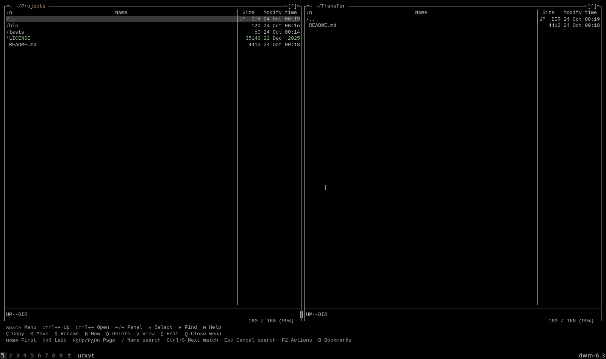
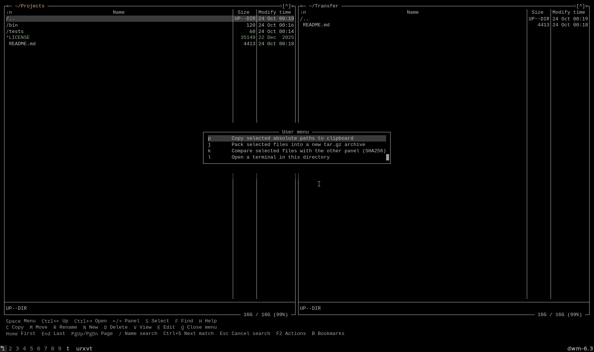

# mc-workflow

My Midnight Commander integration for Void Linux and dwm: a dedicated urxvt window, Neovim editing, a clickable tmux shortcut bar and small file actions.



## Improvements

- Copy selected absolute paths to the clipboard, quoted for use in a shell.
- Pack selected files/directories into a timestamped `.tar.gz`, keeping originals and refusing to overwrite an existing archive.
- Compare selected regular files against same-named files in the other panel using SHA-256.
- Open a terminal in the current local directory.
- Reach MC's native directory hotlist with `B`.



## Keys

| Keys | Action |
| --- | --- |
| `F2`, then `P` | Copy selected paths |
| `F2`, then `J` | Archive selected entries |
| `F2`, then `K` | Compare with the other panel |
| `F2`, then `L` | Open a terminal here |
| `B` | Directory bookmarks; use the dialog's Add current action |
| `S` / Insert | Mark a file |
| `/` | Find a filename in the panel |
| `C` / `M` / `R` | Copy / move / rename |
| `E` | Edit in Neovim |
| `.` | Show hidden files |
| `Ctrl+Left` / `Ctrl+Right` | Parent / open directory |

Letters are pressed without Shift. With no marked files, actions use the highlighted entry. The `..` row is rejected. F2 is the action menu; Space opens the normal MC menu bar. Directory-local `.mc.menu` files take precedence over the user action menu.

The helpers operate on local files. Comparison reports `SAME`, `DIFFERENT`, `MISSING` or `SKIPPED`; it does not synchronize, delete or overwrite anything. Symlinks and directories are skipped for comparison. Archives retain symlinks without following their targets and reject special files. Large archives and hashes run in the foreground; wait for completion before closing MC.

## Files and setup

Requires GNU Midnight Commander, Python 3, tmux, urxvt and Neovim. Clipboard support uses xsel or xclip on X11, or wl-copy on Wayland. Removable-drive discovery uses lsblk and udisksctl. Tested with MC 4.8.33 on Linux.

Back up your existing files, then place the files manually:

| Repository | Destination |
| --- | --- |
| `bin/*` | `~/.local/bin/` |
| `libexec/mc-ensure-settings.py` | `~/.local/libexec/` |
| `config/mc/*` | `~/.config/mc/` |
| `skins/default.ini` | `~/.local/share/mc/skins/default.ini` |

Ensure `~/.local/bin` precedes the system executable directories in PATH and that the scripts are executable. `file-manager-tui` launches the dedicated window. To add only the new actions, copy `bin/mc-tools` and merge the marked block in `config/mc/menu`; `B` is defined in `mc.keymap`. There is no installer.

When launched without directory arguments, the desktop launcher opens home and the first usable removable filesystem; it may ask udisksctl to mount that filesystem. Explicit directory arguments bypass discovery. No drive formatting, partitioning or eject operation is implemented.

The `mc` wrapper uses the normal system MC when optional local image-preview binaries are absent. Those custom binaries are not bundled. The screenshot uses stock MC and example folders. Existing personal image preview and Ventoy helpers can stay installed independently; the public menu does not depend on either.

Existing sessions may retain old key bindings and shortcut bars. Reopen the file manager after changing configuration. Personal histories, saved panel locations, hotlists, credentials and binaries are deliberately excluded.

## Checks

```sh
python3 -m unittest discover -s tests -v
```

Tests cover unusual filenames, clipboard transport, archive preservation and cleanup, no overwrite, comparison outcomes and terminal working directories. The F2 archive/compare actions and B hotlist were also exercised in an actual isolated MC session using temporary files. Removable-drive mounting was not exercised during publication.

## Credits

Built around [GNU Midnight Commander](https://midnight-commander.org/), with its standard [user menu and keymap mechanisms](https://source.midnight-commander.org/man/mc.html). The skin and base configuration derive from MC's defaults. [tmux](https://github.com/tmux/tmux) provides the clickable shortcut bar; urxvt hosts the terminal and Neovim handles editing.

GPL-3.0-or-later; see `LICENSE`. Related: [dwm](https://github.com/merthium/dwm) · [Void config](https://github.com/merthium/void-config).
